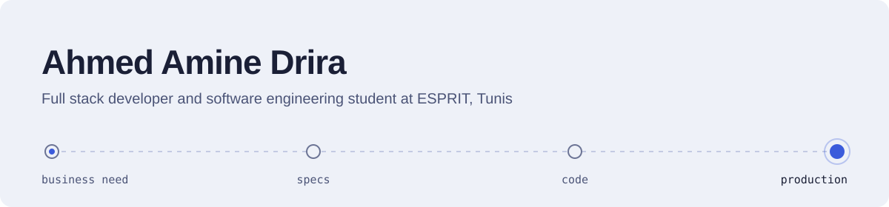
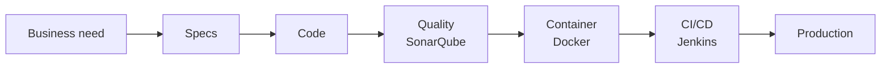

<picture>
  <source media="(prefers-color-scheme: dark)" srcset="./assets/header-dark.svg">
  
</picture>

Final-year software engineering student at **ESPRIT** in Tunis. I build full stack applications, ship them with Docker and CI/CD, and add machine learning where it solves a real business problem: prediction, simulation, clustering and recommendation. Four internships taught me to start from the business need, not from the framework.

> [!NOTE]
> **Looking for a 6-month final-year internship (PFE) starting January 2027.** Full stack development, DevOps and applied AI (machine learning). Based in Tunisia, available for remote interviews and ready to relocate to Europe.
> Reach me on [LinkedIn](https://www.linkedin.com/in/ahmed-amine-drira/) or at [ahmed.a.drira@gmail.com](mailto:ahmed.a.drira@gmail.com).

## Selected work

<!-- Replace SABBOURA_REPO_URL and REPORTCRAFT_REPO_URL with the real links. Remove a row if its repository is private. -->

| Project | What it does | Stack |
|---|---|---|
| [**Network access platform**](https://github.com/AhmeDrira/poulina-internet-access-management) Internship, Poulina Group Holding, 2026 | Digitizes internet and network access requests: validation workflow, SSO login and built-in AI assistance | NestJS, React, OAuth 2.0 / SSO |
| [**BMP**](https://github.com/AhmeDrira/PIDEVxBMP) Construction marketplace | B2B marketplace for the construction sector, mobile-first and installable as a PWA | MongoDB, Express, React, Node.js |
| [**AquaSecure**](https://github.com/YassineSayari/Esprit_5TWIN7_CtrAltElite) Team project (4), ESPRIT, 2026 | Drinking-water monitoring platform. My module, **Projects & Funding**, runs its own AI engines with no external API: Monte-Carlo risk simulation (3,000 runs), Bayesian funder reliability, optimal budget allocation (dynamic programming), funder recommendation, anomaly audit, and a tool-using copilot | Laravel 12, PHP, MySQL |
| [**Sabboura**](https://github.com/YassineSayari/sabboura) Team project (4), ESPRIT, 2026 | Educational platform with an AI assistant: dropout detection, learner clustering and adaptive learning paths | Django, React, scikit-learn |
| [**SmartGrid**](https://github.com/Mehdi-Safraoui/Smart_Grid) Team project (4), ESPRIT, 2026 | Smart grid modelled as an OWL ontology with SPARQL queries and an NLP assistant that turns French questions into SPARQL, without an LLM. I built the consumption and storage parts | OWL, SPARQL, FastAPI, spaCy |

## How I ship

AI coding agents are part of my daily workflow. I use them to move faster, and I stay responsible for every line that ships.

## Stack

| | Main | Also worked with |
|---|---|---|
| **Web** | React, NestJS, Spring Boot | Angular, Node.js / Express, Django, Laravel, Symfony, FastAPI |
| **Mobile & desktop** | React Native | Android, JavaFX, PWA |
| **AI & ML** | scikit-learn, Pandas, LLM integration, prompt engineering | Monte-Carlo simulation, clustering, gradient boosting, RAG, LangChain / LangGraph, MCP, n8n |
| **DevOps** | Docker, Git / GitHub, CI/CD | Jenkins, SonarQube, Kubernetes |
| **Data & APIs** | SQL, MongoDB, REST | GraphQL, OAuth 2.0 / SSO, JWT |
| **Languages** | Java, TypeScript, Python | JavaScript, PHP |
